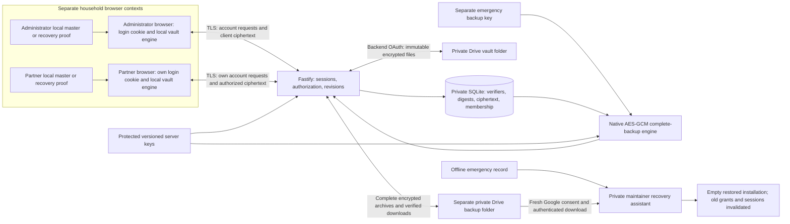

# Lockbox: independent-review briefing

This is a maintainer/reviewer document. It describes the implemented code, not independent certification. Review the source and executable evidence; do not infer security from a green test count. Never provide real keys, database copies, tokens or household passwords with this pack.

## Scope and trust boundaries

React/TypeScript/Vite frontend; single Node 24/Fastify backend; SQLite/better-sqlite3; two distinct username accounts; independent client-encrypted Personal vaults and one Household vault. The administrator connects one central Google account. The other account never receives its Google credentials. There is no Supabase, Google Sign-In, mandatory MFA or implemented Chrome extension.

The backend, its OS account and delivered JavaScript are trusted. Client encryption protects persisted contents and the cloud from plaintext exposure; it does not defend against a malicious application server replacing JavaScript. Google is an untrusted storage/availability boundary, not an identity provider for Lockbox accounts. Writable Drive storage is not deletion-resistant WORM storage.

Master passwords and unwrapped vault keys never traverse the backend API. The emergency backup key is a different, server-held key: it can be shown to a reauthenticated administrator for separate offline custody. It is never uploaded. A complete backup contains server keys/configuration **inside** independent emergency-key encryption; older statements that server keys are never uploaded refer to plaintext keys or the ordinary vault-sync envelope, not this encrypted complete archive.

## Authentication and recovery

`server/auth/service.ts`: ASCII usernames, case-insensitive canonical UNIQUE/CHECK enforcement; Argon2id via argon2 0.45.2, 64 MiB/time 3/parallelism 1/32-byte output; random salts, dummy verification for unknown names, parameter upgrades and bounded hash jobs. Sessions are opaque 256-bit random cookies with server-side SHA-256 digests, 30-minute idle/12-hour absolute lifetime, rotation and revocation. Production uses Secure/HttpOnly/SameSite=Lax/__Host- scope. Device labels are approximate user-agent strings, not cryptographic device authentication.

Mutations require exact Origin and JSON; authenticated mutations additionally require session-bound CSRF. No permissive CORS. Login/IP and account throttles are process-local; restarting the process resets budgets. Resource-concurrency caps remain necessary even for two users.

`server/auth/recovery.ts`: independent 256-bit, domain-separated digest, single-use login recovery codes; generation/replacement requires current password and session/CSRF. Atomic login reset invalidates sessions without re-encrypting vaults. Long-lived saved codes deliberately remain usable until consumed/replaced. Restored older backups can contain old recovery proof; there is no external freshness anchor.

Registration always needs a one-use invitation. The maintainer privately provisions the first administrator invitation; there is no public first-claim race. Phase 7 adds password-confirmed, administrator-only member invitations in Settings using the existing token table/transactions. Replacement invalidates the old invitation, total active-account constraints remain and registration grants no Household key or Personal access. Fragment links prefill the form and remove the capability from the address bar. No tool sends invitations to others automatically.

Login-password-plus-login-code loss has no automatic/partner override. Master-plus-vault-recovery-key loss makes Personal decryption unrecoverable unless a trusted unlocked device retains keys. An authorized partner may preserve Household contents. A lost server plus missing emergency key makes complete backups unreadable. The UI must not promise an identity-assisted reset that has not been implemented.

## Client encryption and sharing

`src/features/vault/crypto.ts`, `kdf.ts`, `kdf.worker.ts`, `engine.ts`: hash-wasm 4.13.0 Argon2id with fixed validated 64 MiB/time 3/p1 and random 16-byte salt in a disposable real browser worker; @noble/ciphers 2.4.0 XChaCha20-Poly1305 with random 24-byte nonces and versioned context-bound authenticated envelopes.

Independent random 256-bit root/Personal/Household keys. Master and recovery wrappers independently unlock the root; root wraps a keyring; Personal and Household documents have different keys. Contexts bind master to account/salt, recovery/keyring to account, vault payload to vault ID/revision and sharing proof to Household ID. Unsupported parameters, malformed documents, tampering and wrong keys fail closed. Master changes rewrap keys; login changes do not affect vault encryption.

Joined Household members collaborate on the shared document. Only its owner grants/removes access; removal rotates the live shared key. Sharing currently requires explicit account permission and an out-of-band Household sharing card. It is not automatic public-key delivery. Old copied data, old wrappers and backups cannot be recalled. Personal access remains session/owner bound. Key memory/clipboard clearing is best effort; OS/browser history and JavaScript garbage collection have limits. No decrypted browser persistence/offline database is implemented.

## API and storage review map

| Boundary                               | Source                                       | Important invariant                                                                                        |
| -------------------------------------- | -------------------------------------------- | ---------------------------------------------------------------------------------------------------------- |
| Route allowlist/schemas/error handling | server/http/app.ts, auth/routes.ts           | Unknown APIs fail; no raw exceptions, request bodies, cookies or callback URLs logged                      |
| Register/login/recovery/invitations    | server/auth/                                 | Parameterized SQL, capacity/uniqueness, session/CSRF and reauthentication where required                   |
| Vault API                              | server/vault/routes.ts                       | Personal owner binding; joined Household check; expected revisions and atomic moves/revocation             |
| Profile/documents                      | shared/client-vault.ts, client crypto/engine | Client-only master/KDF; opaque backend snapshots; no empty reset on decryption failure                     |
| OAuth/Drive                            | server/drive/                                | PKCE/state/session/epoch; backend-only encrypted tokens; fixed HTTPS endpoints; namespace/folder binding   |
| Backup/recovery                        | server/maintenance/                          | Separate emergency encryption, complete-key/config state, authenticated clean restore, no live overwrite   |
| Archive history                        | maintenance/offdevice.ts, vault/routes.ts    | Digest comparison and authorization before/after network work; bounded expensive remote archive operations |
| Private files/migrations               | server/security/, server/database/           | Owner-only ACL/modes, no links, immutable checksums, pre-upgrade backups, key/database binding             |
| Frontend development server            | vite.config.ts                               | Loopback binding and explicit backend/private-file deny rules, including raw filesystem variants           |
| Production ingress                     | deploy/Caddyfile                             | Same-origin TLS/CSP, no CORS, no access logs and removal of request objects from runtime error logs        |

The Phase 1 credentials/folders/encrypted_payloads tables are reserved legacy infrastructure; current content lives in client_vault_profiles/client_vaults. Likewise, legacy disabled Drive scaffolding/config is not the adapter used by server/index.ts. Assess the real entry point, not just historical names.

## Google permission and sync model

Confidential developer-owned web registration. Required scope is `https://www.googleapis.com/auth/drive`; arbitrary pasted existing folders are not authorized by drive.file alone. The code restricts operations to selected owner-only, writable, private My Drive folders and never publishes permissions. A stolen full-scope token nevertheless has broader account power. Google account ownership and possession of a folder link are separate from authorization. Wife's Lockbox account needs neither Google identity nor Drive folder sharing.

OAuth code flow uses offline consent, PKCE S256, ten-minute single-use session-bound state and connection epochs; tokens/PKCE state are sealed at rest with purpose/database-bound HKDF/native AES-256-GCM using protected server keys. Refresh is single-flight; disconnect clears local grants before attempted remote revocation and prevents stale callbacks from resurrecting a connection. Failed Google revocation is reported rather than assumed successful.

Sync publishes immutable encrypted snapshots then immutable commits referencing hashes/parents. Checkpoints distinguish local/remote changes; final SQLite transactions recheck fingerprints/leases. Conflicts retain both branches; every account independently approves a whole-copy replacement. Imports revoke sessions to discard stale keys/revisions. No blind timestamp overwrite, field-level merge, destructive cloud compaction or independent global rollback/freshness guarantee.

## Backups and disaster recovery

Complete archives include consistent SQLite state, protected versioned server keys and portable application configuration, encrypted under a separate random 256-bit emergency key using native AES-256-GCM. Each local success includes an actual isolated restore plus integrity/key/migration checks. Remote success additionally requires ciphertext equality and another authenticated remote-byte restoration. Missing keys with known cloud history, key/backup path overlap and missing unused login-recovery proof fail closed.

Local history compacts only after verifying a matching remote archive; IDs remain unique across live/archive tables. Referenced archives retain local fallbacks and are never automatically deleted remotely. Archive retrieval rechecks session/membership after I/O. Phase 7 serializes expensive remote delivery/inspection/history operations to avoid unbounded authenticated memory/disk pressure. Retention does not prove cloud deletion resistance. Storage/listing bounds and operator monitoring remain necessary.

The loopback-only private recovery assistant requires its protected launch capability, short session/CSRF/Origin/Host checks, fresh Google consent and separately held emergency record. It never receives master passwords. It restores only into empty protected paths, verifies expected database identity, clears sessions/Google grants, preserves encrypted data/history and requires each person's own account/vault recovery. Unconfirmed revocation and old backup dates are visible. No manual reset-flag bypass is permitted.

## Threat model and retained risks

| Actor/failure                            | Mitigation                                                                    | Residual risk                                                                                 |
| ---------------------------------------- | ----------------------------------------------------------------------------- | --------------------------------------------------------------------------------------------- |
| Unknown remote caller / guessed username | Invitations, Argon2id, generic errors, limits, cookies/CSRF/Origin            | Online DoS; process-local throttles; no mandatory MFA                                         |
| Compromised household session            | Owner/Household authorization, reauthentication for invitation/key disclosure | Authorized shared contents and unlocked client memory remain exposed                          |
| Cloud reader/writer or lost backup       | Client encryption, authenticated envelopes/digests, independent backup key    | Deletion/rollback and account-wide OAuth scope; no WORM                                       |
| Stolen laptop                            | Inactivity lock, session revocation, no persistent decrypted keys             | Unlocked memory, malware, clipboard/history, browser vulnerabilities                          |
| Malicious backend/JS update              | Protected host/release/dependency controls                                    | Can steal passwords/unlocked keys; client encryption does not solve this boundary             |
| Database/server loss                     | Verified complete remote backup and external emergency record                 | Cannot recover missing proofs; real physical Google recovery still unverified                 |
| Concurrent edits/recovery                | Conditional revisions, transactions, immutable heads, independent approvals   | Whole-copy conflicts can block when one account is unavailable                                |
| Development server file read             | Phase 7 deny policy and canary tests                                          | Dev tooling/plugins are not a production isolation boundary; use dist-only production ingress |

## Evidence and work for an independent reviewer

Phase 7 adds actual Chrome/Edge **runtime** diagnostics with separate private profiles, real WASM workers/cookies/network failure and graceful reopen. The diagnostic page is not the Lockbox UI. Component UI tests still use HappyDOM. Full native UI automation was not performed because the computer-use guidance prohibits password-manager UI automation; manual UI/visual/mobile acceptance remains necessary.

Actual checksum-verified portable Caddy v2.11.9 adapts the production file and runs a derived loopback TLS/private-admin rehearsal with ephemeral test certificates. It exercises auth, headers, origin restrictions, error-log redaction and graceful stop. Linux/systemd, public DNS/CA issuance, real device hardware and Google registration/consent/physical off-device recovery are not validated by those results.

Provide the reviewer source, package lock, current reports/results, a disposable isolated deployment and synthetic fixtures. Ask them to assess cipher/library composition, nonce/AAD/key lifecycle, server/JS trust, recovery proof replay, OAuth breadth/state/refresh/revocation, archive freshness/retention, authorization/races, rate/resource limits, logging and production host/extension boundaries. Record findings/remediation and retest. Do not provide actual household secrets or call this internal pack an independent assessment.
